# Pixel House

작은 픽셀 집에서 고양이(또는 강아지)와 함께 하루를 챙기는 맥 앱이에요.
물 마시기, 습관, 약속, 공부, 잠, 읽은 책 같은 생활 기록을 **내 컴퓨터 안의 파일 하나**에 차곡차곡 남겨요.

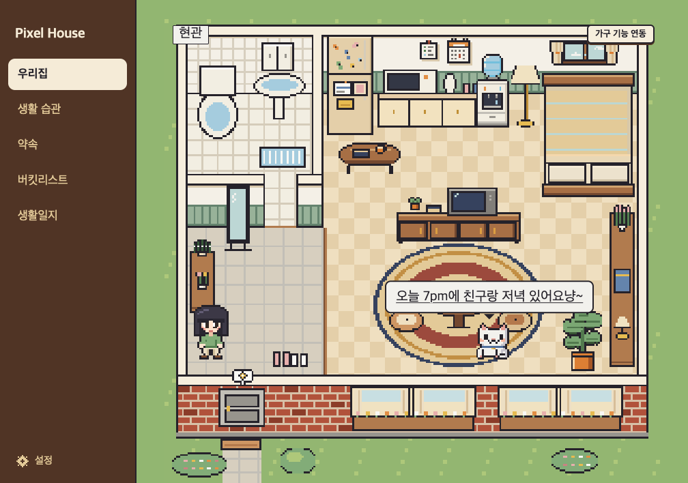

- **계정도, 인터넷도 필요 없어요.** 앱은 인터넷에 연결하지 않아요. 기록은 내가 고른 폴더에만 남아요.
- **펫은 재촉하지 않아요.** 정해진 말로 인사하고 챙겨 줄 뿐, 점수를 매기거나 혼내지 않아요.
- **집이 곧 메뉴예요.** 물컵을 누르면 물 기록, 책꽂이를 누르면 독서 기록처럼 가구를 눌러 기록해요.

> 비유하자면, 다이어리를 펼치는 대신 작은 집에 들어가서 가구를 하나씩 만져 보는 느낌이에요.

---

## 목차

1. [준비물](#준비물)
2. [설치하기](#설치하기)
3. [처음 열 때: 경고 넘기기](#처음-열-때-경고-넘기기)
4. [처음 실행: 집 꾸리기](#처음-실행-집-꾸리기)
5. [집에 들어가기](#집에-들어가기)
6. [기능별 사용법](#기능별-사용법)
7. [설정](#설정)
8. [기록 파일은 어디에 있나요?](#기록-파일은-어디에-있나요)
9. [자주 묻는 질문](#자주-묻는-질문)
10. [개발자용: 소스에서 실행하기](#개발자용-소스에서-실행하기)

---

## 준비물

- **애플 실리콘(M1·M2·M3·M4 등) 맥**이 필요해요. 설치 파일(dmg)이 애플 실리콘용만 있어서 인텔 맥에서는 열리지 않아요.
  - 내 맥이 어떤 칩인지 모르겠다면: 화면 왼쪽 위 사과 모양() > **이 Mac에 관하여**를 눌러 "칩" 줄을 봐요. "Apple M..."이라고 적혀 있으면 돼요.
- 윈도우 컴퓨터와 휴대폰에서는 아직 쓸 수 없어요.

---

## 설치하기

> **dmg 파일**이란? 맥에서 앱을 나눠 줄 때 쓰는 "포장 상자" 같은 파일이에요. 열면 안에 앱이 들어 있어요.

1. [Releases 페이지](https://github.com/dangnuie-web/pixel-house/releases/latest)에서 `Pixel House-0.1.0-arm64.dmg` 파일을 받아요.
2. 받은 dmg 파일을 더블클릭해서 열어요.
3. 창 안에 **Pixel House** 아이콘과 **Applications**(응용 프로그램) 폴더 바로가기가 보여요. Pixel House 아이콘을 Applications 쪽으로 끌어다 놓아요.
4. 다 옮겼으면 dmg 창은 닫아도 돼요. Finder 왼쪽 목록에서 dmg 이름 옆 **꺼내기(⏏)** 버튼을 눌러 정리해요.

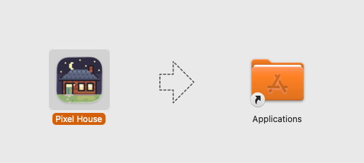

---

## 처음 열 때: 경고 넘기기

Pixel House는 애플의 개발자 **서명**을 받지 않은 앱이에요.

> **서명**이란? 앱에 붙이는 "애플이 확인한 신분증" 같은 거예요. 신분증이 없는 앱은 맥이 처음 한 번 "정말 열어도 돼요?" 하고 막아요. 앱이 위험하다는 뜻은 아니고, 애플 확인을 거치지 않았다는 뜻이에요.

처음 한 번만 아래처럼 허락해 주면, 그다음부터는 그냥 열려요.

1. **응용 프로그램** 폴더에서 **Pixel House**를 더블클릭해요.
2. "'Pixel House'을(를) 열지 않음" 경고 창이 떠요. **완료**를 눌러 창을 닫아요.
   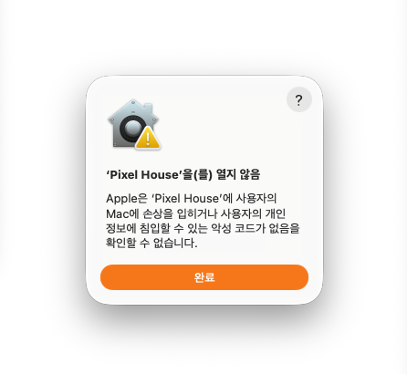
3. 화면 왼쪽 위 사과 모양() > **시스템 설정**을 열어요.
4. 왼쪽 목록에서 **개인정보 보호 및 보안**을 눌러요.
5. 오른쪽 화면을 아래로 내리면 "Mac을 보호하기 위해 'Pixel House'을(를) 차단했습니다." 문구가 보여요. 옆의 **그래도 열기**를 눌러요.
   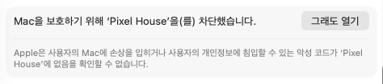
6. 맥 로그인 암호(또는 Touch ID)를 넣어 확인해요.
7. 다시 한 번 묻는 창이 뜨면 **그래도 열기**(또는 **열기**)를 눌러요.

> **그래도 열기 버튼이 안 보여요!**
> 1번(앱을 한 번 열어 보기)을 먼저 해야 버튼이 생겨요. 또 이 버튼은 앱을 열려고 한 뒤 한동안만(약 1시간) 보인다고 알려져 있어요. 안 보이면 1번부터 다시 해 봐요.

> 예전 맥(macOS 14 Sonoma 이하)에서는 앱을 **우클릭(또는 control 키를 누른 채 클릭) > 열기**로도 열 수 있어요. macOS 15 Sequoia부터는 이 방법이 막혀서 위 순서대로 해야 해요.

> **"손상되었기 때문에 열 수 없습니다"라고 떠요!** → [자주 묻는 질문](#자주-묻는-질문)을 봐요.

---

## 처음 실행: 집 꾸리기

앱을 처음 열면 집사 고양이가 차례로 몇 가지를 물어봐요. 위쪽의 단계 표시(이름 · 고양이 · 모습 · 집 · 기록 폴더 · 습관)로 지금 어디쯤인지 알 수 있어요. 언제든 **이전**을 눌러 돌아갈 수 있어요.

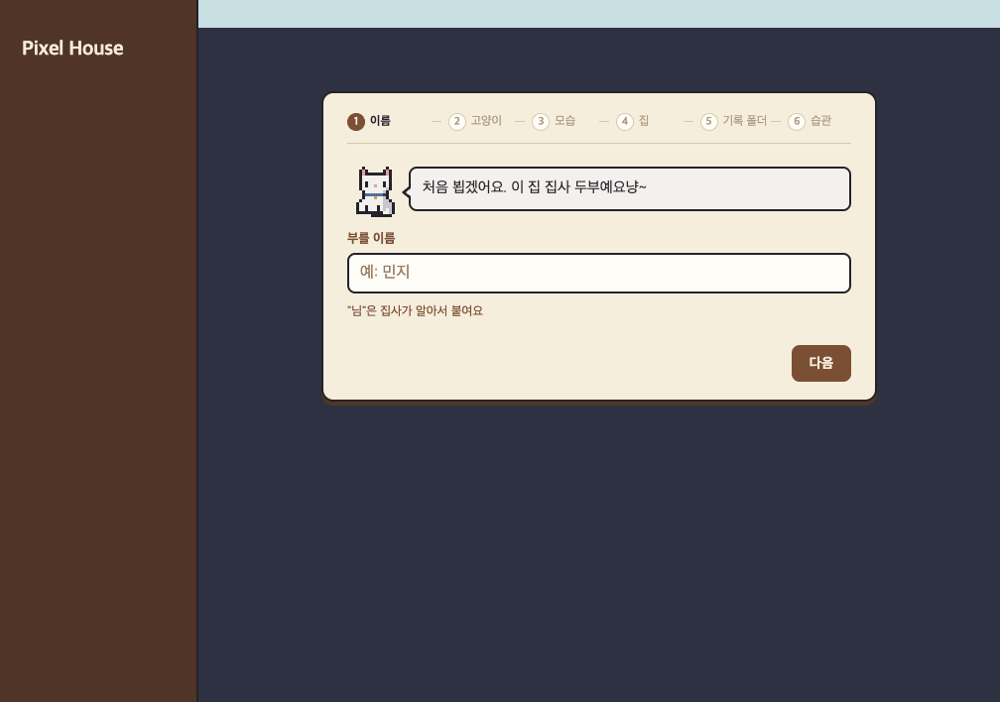

1. **내 이름**: 고양이가 불러 줄 이름을 적어요. "님"은 고양이가 알아서 붙여 줘요. 12자까지.
2. **고양이 이름**: 같이 살 고양이 이름을 지어 줘요. 비워 두면 **두부**예요. 나중에 설정에서 바꿀 수 있어요.
3. **내 모습**: 집 안을 걸어 다닐 캐릭터(아바타)를 셋 중 하나 골라요.
4. **집 고르기**: **원룸 · 투룸 · 쓰리룸** 중 하나를 골라요. 오른쪽 미리보기로 집 모양을 볼 수 있어요. 집은 나중에 설정에서도 바꿀 수 있어요.

   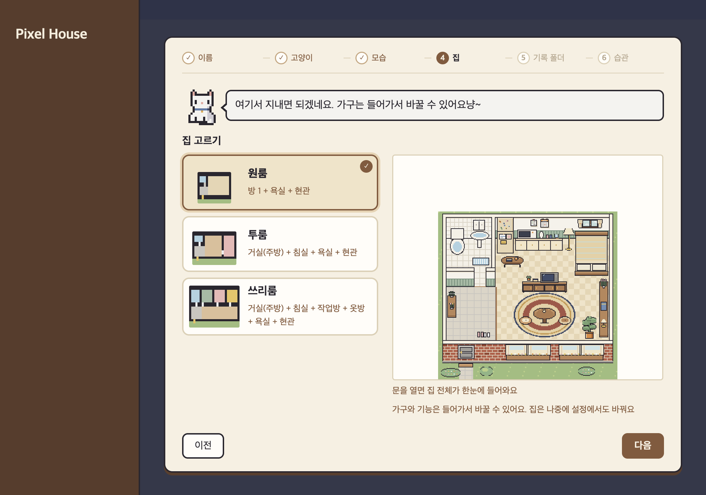

5. **기록 폴더**: 내 생활 기록 파일을 넣어 둘 "서랍"이에요. 기본은 **문서** 폴더 안 `PixelHouse` 폴더(`~/Documents/PixelHouse`)예요. 다른 곳에 두려면 **폴더 고르기**를 눌러요.
   - 고른 폴더에 `PixelHouse_생활기록.md` 파일이 하나 생겨요. 이미 있으면 지우지 않고 **이어서** 써요.
6. **습관 고르기**: 챙기고 싶은 습관을 눌러 골라요. 목록에 없는 습관은 아래 칸에 적고 **+ 추가**를 눌러요. 다 골랐으면 **들어가기**, 안 고르려면 **건너뛰기**.
   - 습관은 나중에 **생활 습관** 탭에서 언제든 더하고 뺄 수 있어요.

---

## 집에 들어가기

1. 집 앞 화면에서 **입장하기**를 누르거나 현관문을 눌러요.
2. 내 캐릭터가 문을 열고 들어오고, 펫이 맞이해 줘요.
3. 집 안에서는 **방향키**로 걸어 다니고, 가구를 누르거나 가구 옆에서 **Space**를 눌러요.

화면 왼쪽 **사이드바**(옆 메뉴)에는 탭이 있어요.

| 탭 | 하는 일 |
|---|---|
| 우리집 | 집 안을 보고, 가구를 눌러 기록해요 |
| 생활 습관 | 오늘 할 습관 체크, 공부 계획, 기록 카드(대변·식사·잠·독서 등) |
| 약속 | 오늘 약속과 달력을 봐요 |
| 버킷리스트 | 하고 싶은 일 목록 (한 줄이라도 적으면 나타나요) |
| 생활일지 | 쌓인 기록을 탭마다(잠·식사·공부·영화 등) 돌아봐요 |

- 열린 창은 **Esc** 키로 닫을 수 있어요.
- 사이드바 맨 아래 **설정**(톱니)에서 펫·집·내 모습·사이드바 탭을 바꿔요. → [설정](#설정)

---

## 기능별 사용법

### 가구를 눌러 기록하기 (우리집)

집 안 가구마다 기능이 하나씩 붙어 있어요. 가구를 누르면 그 기능 창이 열려요. 원룸의 처음 연결은 아래와 같아요. (투룸·쓰리룸은 가구가 더 많아요.)

| 가구 | 기능 |
|---|---|
| 물컵 | 물 한 잔 기록 (누를 때마다 +1) |
| 침대 | 하루 마감 (아침·낮에는 잠 기록 창) |
| 냉장고 | 오늘 약속 메모 |
| 벽 달력 | 약속 달력 |
| 책꽂이 | 독서 기록 |
| TV장 | 영화 기록 |
| 탁자 | 식사 일지 |
| 러그 | 요가 |
| 책상 | 공부 |
| 변기 | 대변 일지 |
| 주방장 | 살림 (생활용품 목록) |
| 벽 메모지 | 버킷리스트 |

### 생활 습관 체크하기

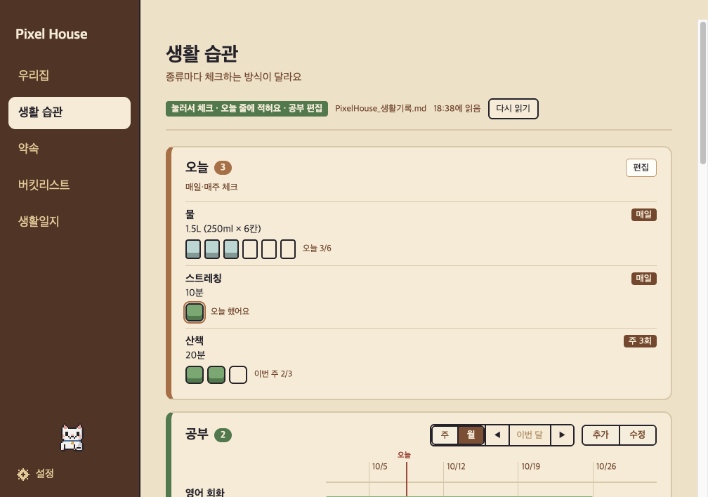

1. 사이드바에서 **생활 습관** 탭을 눌러요.
2. 오늘 한 습관을 눌러 체크해요. 물은 칸을 눌러 잔 수를 채워요(하루 6잔).
3. 습관을 더하거나 고치려면 습관 카드의 편집 버튼을 눌러요.

- 습관마다 주기가 있어요: **매일**, **주 n회**, **월 n회**. "기록"형 습관(예: 독서)은 할 때만 양을 적어요.
- 같은 탭의 **기록** 카드에서 대변·식사·잠을, 독서·영화 카드에서 **기록하기**로 바로 적을 수 있어요.

### 공부 계획

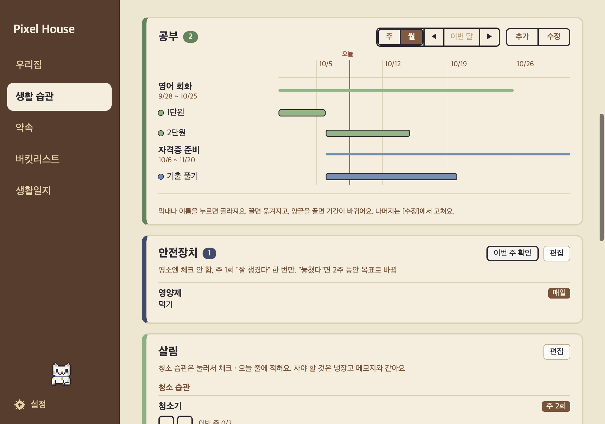

1. **생활 습관** 탭의 **공부** 카드에서 **추가**를 눌러요. (집 안 **책상**을 눌러도 돼요.)
2. 공부 이름과 전체 기간(시작일·끝일)을 정하고, 필요하면 **세부 계획**(예: 1단원, 기출 풀기)을 더해요.
3. 기간이 막대로 그려져요. 막대를 끌면 옮겨지고, 양끝을 끌면 기간이 바뀌어요. 나머지는 **수정**에서 고쳐요.

### 잠 기록

1. **생활 습관** 탭 **기록** 카드의 잠 줄에서 **기록하기**를 눌러요. (아침·낮에 침대를 눌러도 같은 창이 열려요.)
2. 시간 칸을 형광펜 긋듯 끌어서 잔 시간을 칠해요. 펜은 **잠 · 선잠 · 지우개** 세 가지예요.
3. **저장**을 눌러요.

### 생활일지

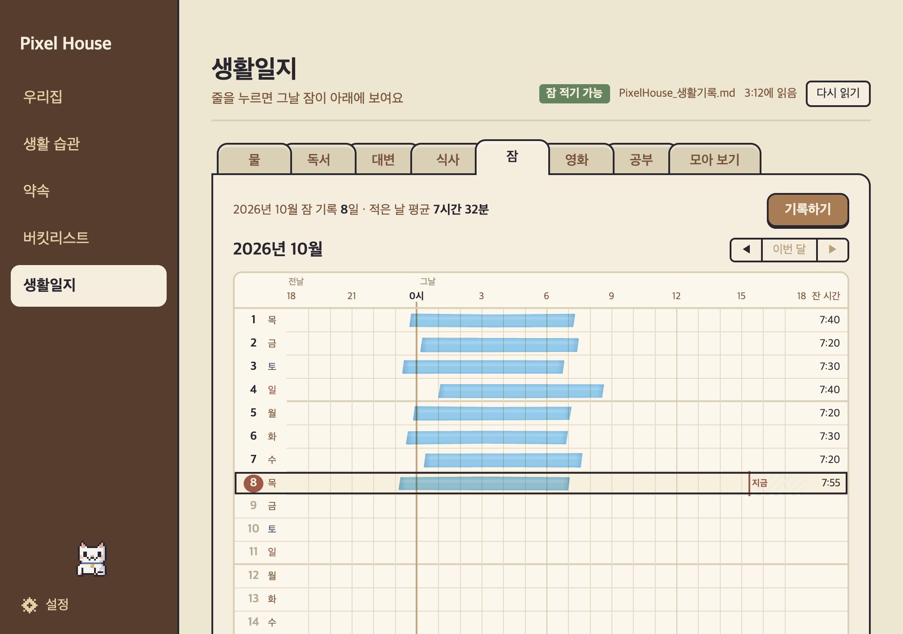

1. 사이드바에서 **생활일지** 탭을 눌러요.
2. 위쪽 탭(습관·식사·잠·공부·영화 등)을 골라 지난 기록을 봐요.
   - **잠**: 한 달을 모눈 한 장으로 봐요. 잔 시간이 형광펜처럼 칠해져요.
   - **공부**: 달마다 계획이 있던 날이 **잔디**(날짜 칸이 초록으로 물드는 표)로 보여요.

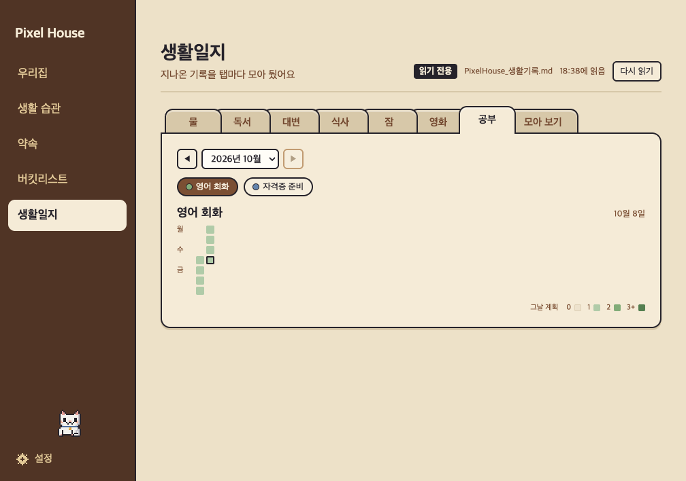

### 독서 · 영화 기록

1. 책꽂이(독서)나 TV장(영화)을 눌러요. 생활 습관 탭의 카드에서 **기록하기**를 눌러도 돼요.
2. 제목, 날짜, 짧은 요약을 적고 저장해요. 다 읽은 책은 책꽂이에 한 권씩 꽂혀요.
3. 영화·독서 말고 나만의 기록 칸(예: 공연, 전시)은 습관 편집의 **+ 추가**에서 "기록" 방식으로 만들 수 있어요.

### 약속

1. 사이드바에서 **약속** 탭을 눌러요. (집 안 **벽 달력**을 눌러도 열려요.)
2. 맨 위 **오늘 약속**에서 오늘 일정을 보고, 달력에서 날짜를 골라 약속을 적어요.

### 버킷리스트 (하고 싶은 일 목록)

1. 집 벽에 붙은 **메모지**를 눌러요. (아직 적은 게 없으면 생활 습관 탭 맨 아래 카드에서도 적을 수 있어요.)
2. **+ 적기**를 누르고 하고 싶은 일을 한 줄 적은 뒤 **Enter**나 **저장**을 눌러요.
3. 이룬 일은 줄 앞 체크 칸을 눌러 **완료**로 옮겨요. 글씨를 누르면 **고치기 · 지우기**가 나오고, 지운 뒤 잠깐 뜨는 **되돌리기**로 되살릴 수 있어요.

### 옷 갈아입기

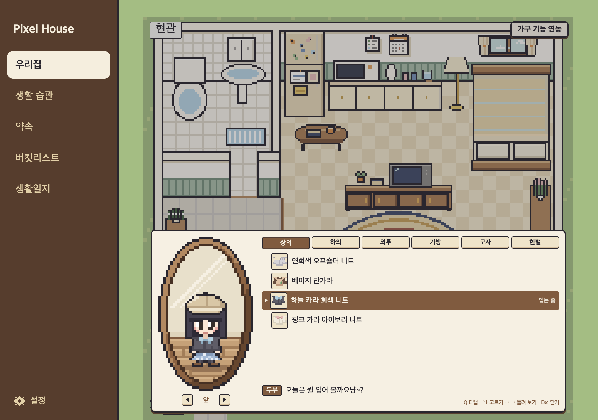

1. 옷장(투룸·쓰리룸)을 누르거나, 원룸에서는 **가구 기능 연동**으로 원하는 가구에 "옷 갈아입기"를 붙여요.
2. 위쪽 탭(상의·하의·외투·가방·모자·한벌)에서 옷을 골라요. 고르면 거울과 집 안 캐릭터가 바로 바뀌어요.
3. 처음 모습으로 돌아가려면 **한벌** 탭의 **처음 옷**을 골라요.

### 가구 바꾸기 · 기능 바꾸기

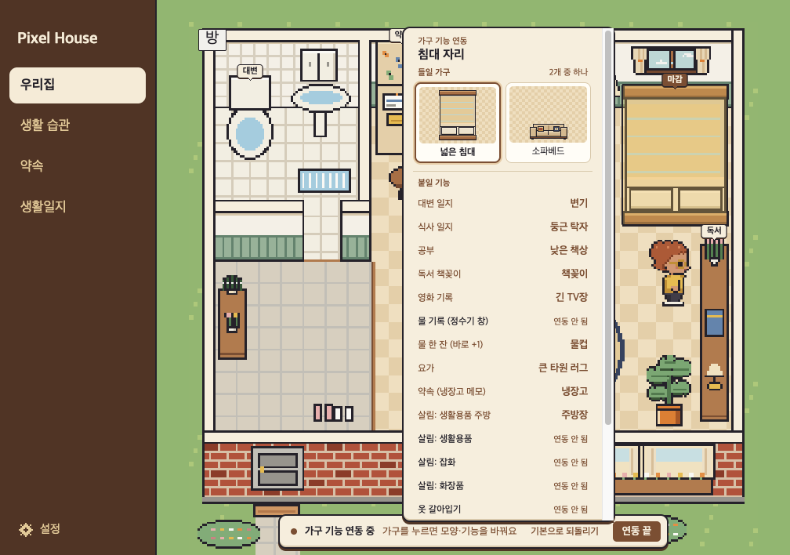

1. **우리집** 탭 오른쪽 위 **가구 기능 연동** 버튼을 눌러요.
2. 바꾸고 싶은 가구를 눌러요.
3. **들일 가구**에서 다른 모양을 골라요. (예: 넓은 침대 → 소파베드)
4. **붙일 기능**에서 이 가구에 붙일 기능을 골라요.
5. 다 했으면 **연동 끝**을 눌러요.

- 기능 하나는 가구 하나에만 붙어요. 처음 상태로 돌리려면 **기본으로 되돌리기**를 눌러요.
- 가구를 바꿀 수 있는 자리는 정해져 있어요.

### 낮과 밤

컴퓨터 시각에 따라 집이 낮 화면, 밤 화면으로 바뀌어요.

---

## 설정

사이드바 맨 아래 **설정**(톱니)을 눌러요. 바꾸면 바로 적용돼요.

| 탭 | 바꿀 수 있는 것 |
|---|---|
| 펫 | 함께 사는 펫(흰·치즈·검은 고양이, 흰·노란 강아지), 펫 이름 |
| 집 | 하우스 이름(사이드바 맨 위), 집 도면(원룸·투룸·쓰리룸) |
| 내 모습 | 아바타 |
| 사이드바 | 보일 탭 고르기 |

- 펫이나 집을 바꿔도 기록은 그대로예요.

---

## 기록 파일은 어디에 있나요?

| 무엇 | 어디에 |
|---|---|
| 내 생활 기록 | 처음 고른 기록 폴더 안 `PixelHouse_생활기록.md` (기본: `~/Documents/PixelHouse/`) |
| 앱 설정 (이름·펫·아바타·집·고른 폴더) | `~/Library/Application Support/Pixel House/profile.json` |
| 옷차림·가구 연결 | 같은 폴더의 `outfit.json`, `features.json` |
| 자동 백업 | `~/Library/Application Support/Pixel House/backup/` (앱이 기록하기 직전 사본, 최근 10개) |

> **`~`(물결표)**란? "내 사용자 폴더"를 줄여 쓴 표시예요. 예를 들어 `~/Documents`는 내 **문서** 폴더예요.

### 라이브러리 폴더 여는 법

`~/Library` 폴더는 평소에 숨겨져 있어요.

1. **Finder**를 열어요.
2. 맨 위 메뉴에서 **이동 > 폴더로 이동**을 눌러요. (단축키 `⌘ Command + ⇧ Shift + G`)
3. `~/Library/Application Support/Pixel House` 를 붙여 넣고 **Enter**를 눌러요.

### 기록 파일을 직접 고쳐도 되나요?

네. `.md` 파일은 메모장 같은 글 파일이라 텍스트 편집기로 열 수 있어요.

- **표 모양(| 로 나눈 칸)만 지키면** 직접 고쳐도 돼요. 앱이 바뀐 걸 알아채고 다시 읽어요.
- 망가뜨렸을 때를 위해 위 **자동 백업** 폴더에 사본이 남아 있어요.

---

## 자주 묻는 질문

**Q. 내 기록이 인터넷 어딘가에 올라가나요?**
아니요. 앱은 인터넷에 연결하지 않아요. 기록은 내가 고른 폴더의 파일 하나에만 있어요.

**Q. 처음부터 다시 하고 싶어요.**
앱을 끄고 `~/Library/Application Support/Pixel House/profile.json` 파일을 휴지통에 넣은 뒤 다시 열어요. 처음 실행 단계가 다시 나와요. 기록 파일은 지워지지 않고 그대로 남아요. (같은 기록 폴더를 고르면 이어서 써요.)

**Q. 다른 맥으로 옮기고 싶어요.**
기록 폴더 안 `PixelHouse_생활기록.md` 파일을 새 맥으로 복사해요. 새 맥에서 앱을 처음 열 때 기록 폴더 단계에서 그 파일이 든 폴더를 고르면 이어서 써요.

**Q. 기록 폴더를 아이클라우드 드라이브 안에 둬도 되나요?**
시험해 보지 않았어요. 두 맥에서 동시에 쓰면 파일이 겹칠 수 있어요.

**Q. "Pixel House이(가) 손상되었기 때문에 열 수 없습니다"라고 떠요.**
지금 판은 임시 서명을 넣어서, 이 경고 대신 위 "처음 열 때"의 "'Pixel House'을(를) 열지 않음" 경고가 떠요. 그래도 "손상되었기"가 뜨면 받는 중에 파일이 깨졌을 수 있어요. dmg를 지우고 다시 받아서, 위 "처음 열 때" 순서대로 열어 봐요.

**Q. 그래도 열기 버튼이 안 보여요.**
앱을 한 번 열어서 경고 창을 본 다음, 시스템 설정 > 개인정보 보호 및 보안으로 가야 버튼이 나와요. 위 "처음 열 때" 순서를 다시 따라 해 봐요.

**Q. 인텔 맥이나 윈도우에서도 쓸 수 있나요?**
아직은 애플 실리콘 맥에서만 쓸 수 있어요.

**Q. 펫이 말을 안 들어요 / 엉뚱한 말을 해요.**
펫은 미리 정해 둔 말 중에서 골라 말해요. AI가 아니라서 대화를 알아듣지는 못해요.

---

## 라이선스와 출처

코드는 MIT 라이선스예요. 픽셀 그림과 캐릭터(집·가구·고양이 두부·아바타·옷, 스크린샷)는 Dangnee에게 저작권이 있어 앱 밖에서 다시 쓸 수 없어요. 자세한 내용은 [LICENSE](LICENSE), 그림·글꼴·코드 출처는 [출처.md](출처.md)에 있어요.

---

## 개발자용: 소스에서 실행하기

필요한 것: macOS(애플 실리콘), [Node.js](https://nodejs.org) 22.12 이상, 인터넷

```sh
npm ci        # package-lock.json 판 그대로 설치 (npm install 도 됨)
npm start
```

- **처음 `npm start`(또는 `npm test`) 때 Electron 실행 파일을 한 번 받아요(약 100MB).** `npm ci`는 Electron 실행 파일을 받지 않고, 처음 실행할 때 "Downloading Electron..."이 뜬 뒤 받아요. 한 번 받으면 다시 안 받아요.
- 맥 앱 만들기: `npm run dist:mac` → `dist/` 폴더에 `.dmg`와 `.app`이 생겨요. (Electron 실행 파일이 아직 없으면 먼저 받은 뒤 만들어요. 임시 서명(ad-hoc)은 하지만 애플 개발자 서명·공증은 받지 않아서, 받은 앱을 처음 열 때 경고가 떠요.)
- 시험: `npm test` (실제 앱 창을 투명하게 띄워 시험해요. 내 앱 설정·기록 폴더는 쓰지 않아요. 계산 시험과 온보딩 → 입장 → 가구 기능 → 집 꾸미기 → 설정 → 공부·잠·기록·버킷·옷 갈아입기를 따라가요.)
